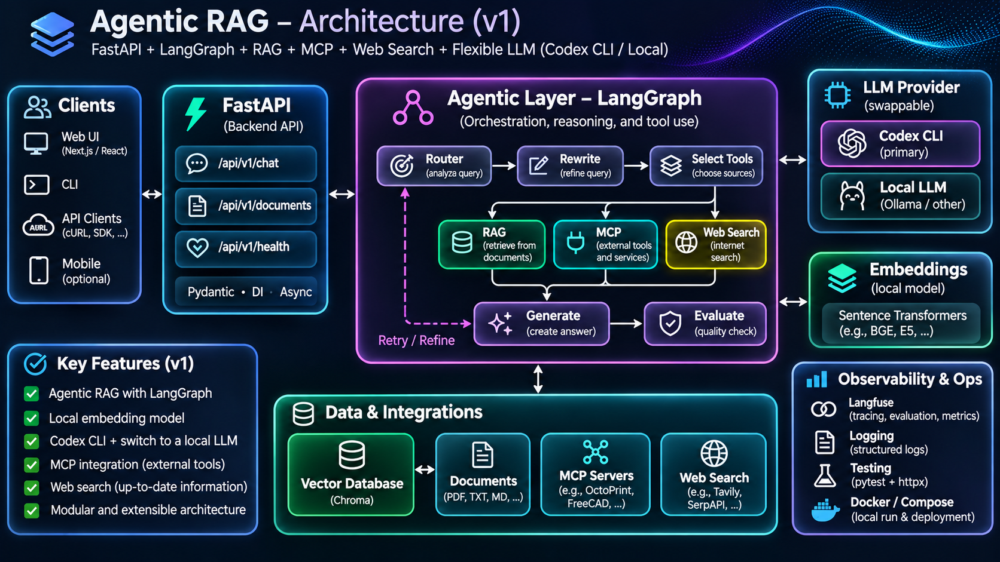

# Agentic RAG

**Status: In development.**

This project contains a FastAPI application, local document ingestion with embeddings and a persistent vector database, and basic document question answering with citations.

## Architecture

The diagram shows the target architecture; several components and endpoints are planned and are not yet implemented. See the [architecture documentation](docs/architecture.md) for the current scope and planned workflow.



## Getting started

Python 3.10 or later is required. Create and activate a virtual environment in the project root, then install the application and development dependencies:

```powershell
python -m venv .venv
.\.venv\Scripts\Activate.ps1
python -m pip install -e ".[dev]"
```

Optionally, copy `.env.example` to `.env` and adjust the configuration. Environment variables take precedence over values in `.env`.

```powershell
uvicorn app.main:app --reload
```

The health endpoint is available at `http://127.0.0.1:8000/api/v1/health` and interactive API documentation at `http://127.0.0.1:8000/docs`. The endpoint confirms that the API is running; it does not currently check external services.

## LLM provider

Select a provider using `AGENTIC_RAG_LLM_PROVIDER` (`ollama` or `codex`); see `.env.example` for an example configuration. Settings are loaded when the application starts, so restart it after changing `.env`.

For Ollama, start the server and download the model specified by `AGENTIC_RAG_OLLAMA_MODEL` locally (default: `llama3.2`). Set `AGENTIC_RAG_OLLAMA_BASE_URL` to change the server address. For Codex, install and authenticate Codex CLI on the machine running the API; optionally configure the executable path and model. Codex is an agent with tools, and its read-only sandbox may not be available on every platform; it is not equivalent to a purely local LLM.

Both adapters expose a synchronous `generate(prompt: str) -> str` method and raise `LLMProviderError` on failure. The call blocks; run it outside the event loop when using it in an asynchronous endpoint. Use `get_llm_provider` for dependency injection.

## Document ingestion

Ingest a UTF-8 `.txt`, `.md`, or text-based `.pdf` file, or recursively ingest supported files in a directory:

```powershell
python -m scripts.ingest_documents data/documents
```

The configured Sentence Transformers model runs on CPU. On first use, its weights may be downloaded from Hugging Face and cached locally; subsequent use can use the cache. The Python dependencies include PyTorch and can require substantial disk space. Set `AGENTIC_RAG_EMBEDDING_MODEL`, `AGENTIC_RAG_CHROMA_PATH`, `AGENTIC_RAG_CHROMA_COLLECTION`, `AGENTIC_RAG_CHUNK_SIZE`, and `AGENTIC_RAG_CHUNK_OVERLAP` in `.env` as needed. Chunk sizes are measured in characters, not model tokens; long chunks may be truncated by the model. Overlap must be smaller than the chunk size.

Chroma data is stored locally under `data/chroma` by default. Reingesting the same resolved file path replaces its existing chunks, including stale chunks; removing or renaming a source file does not automatically remove its old entries. Source paths are stored in metadata. Use a new collection and reingest documents when changing the embedding model. PDF extraction does not perform OCR, and page numbers are not yet preserved. Do not run concurrent ingestion for the same source.

## Ask questions about documents

After ingesting documents and starting the API, send a question to `POST /api/v1/chat`:

```powershell
Invoke-RestMethod -Method Post -Uri http://127.0.0.1:8000/api/v1/chat `
  -ContentType 'application/json' -Body '{"question":"What do the documents say?"}'
```

The response contains an `answer` with citation markers such as `[S1]` and a `citations` list with the corresponding source path, chunk index, and excerpt. Source paths and excerpts are returned to the caller. If no chunks are stored, the API returns a message with an empty citation list without calling the LLM. Retrieval failures return HTTP 503; provider failures or invalid citations return HTTP 502.

The service checks that cited IDs correspond to retrieved chunks; it does not verify that each claim is supported by its citation. Similarity search currently has no relevance threshold, so retrieved chunks may be unrelated to the question. Document text is untrusted input, and prompt instructions alone cannot guarantee protection against prompt injection. The Codex CLI provider is an agent: its read-only sandbox may still allow it to read local files. Do not use it with untrusted questions or documents unless the process is isolated from sensitive data. Ensure the configured provider is running and the embedding model is available before using the endpoint.

Citation validation recognizes source-style markers such as `[S1]`; other citation formats are not comprehensively validated. Bracketed letter-and-number labels such as `[C1]` can be mistaken for citations and cause the response to be rejected.

## Tests

```powershell
python -m pytest
```

Run static analysis with `python -m ruff check .`. The workflow for implementation tasks is described in `AGENTS.md`.

