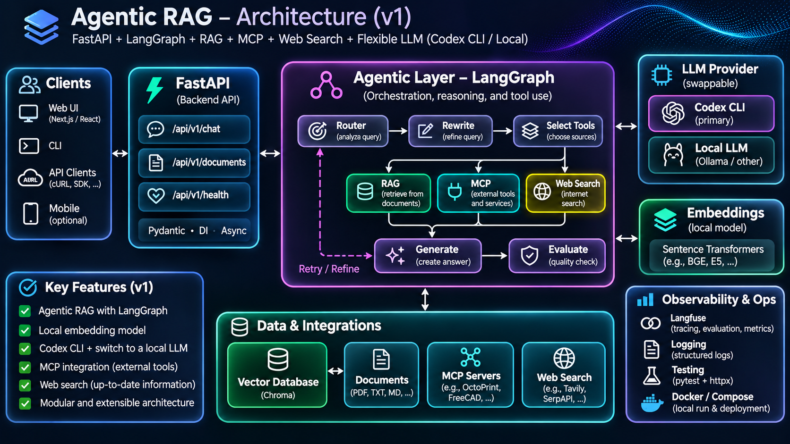
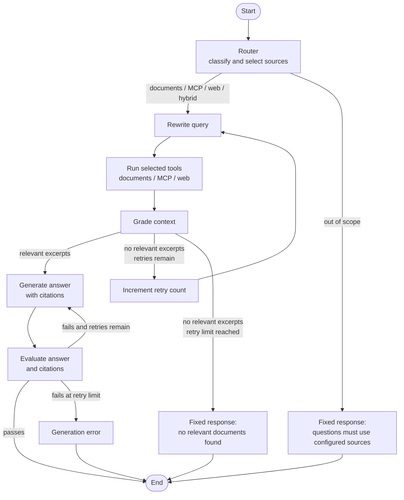

# Agentic RAG architecture

**Status: In development.**

The diagram describes the target architecture for version 1. It is a design overview, not an inventory of implemented features.

Clients communicate with a FastAPI backend. The agent layer uses LangGraph to route and refine queries, select information sources, retrieve and grade context, generate answers, and evaluate results with bounded retries. Agentic mode can use document retrieval, a configured MCP server, and Tavily web search. Providers are interchangeable, with local embeddings and Chroma supporting document retrieval. The diagram also outlines planned observability and deployment components.

The current implementation provides the FastAPI skeleton, health endpoint, a common interface with Codex CLI and Ollama adapters, local embeddings, document ingestion, persistent Chroma storage, and a chat endpoint with basic and LangGraph agentic RAG modes. Agentic mode includes a tool registry, MCP Streamable HTTP client, optional Tavily web search, and LLM-based source selection. The observability and deployment integrations remain planned.

## LangGraph workflow

The workflow selects among configured document, MCP, and web sources before query rewriting and retrieval. It grades the returned context, generates an answer, and evaluates the answer. Retrieval retries when the context is not relevant, and generation retries when the answer does not pass evaluation, up to the configured limit. Out-of-scope requests and exhausted retrieval attempts return a fixed response; exhausted answer retries return an error.

